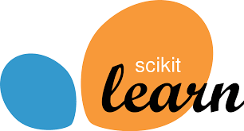
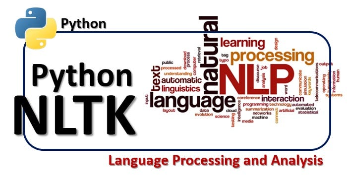
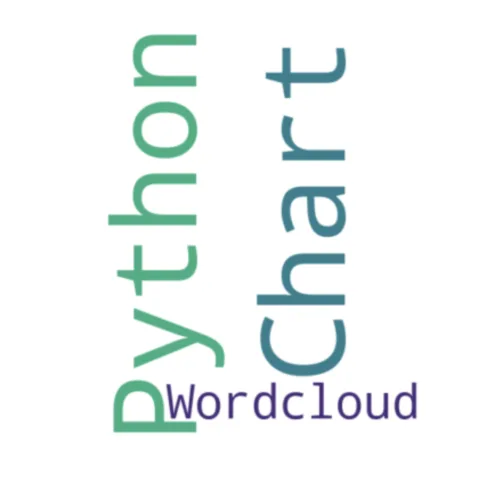

## Agenda

</br>

1.  Introduction to text analytics
2.  Text cleaning and word clouds
3.  Topic modeling with Latent Dirichlet Allocation
4.  Conclusions

# Introduction to Text Analytics

## Text data

</br>

So far, we have worked mainly with numerical and categorical variables.

. . .

However, a large amount of information is stored in the form of **text**.

::: incremental
- Comments on social media.
- Reviews of movies, products, and services.
- Responses to open-ended survey questions.
- Customer complaints.
:::

## Text analytics

</br>

> Text analytics is the process of extracting useful information from text data.

. . .

In this topic, we will transform text into numerical data that can be summarized and visualized.

</br>

Our goal is not to read every document individually, but to identify patterns across many documents.

## Example: Movie reviews

</br>

Imagine that you work for a movie streaming platform and have access to thousands of written reviews.

Reading all the reviews manually would take a considerable amount of time.

. . .

</br>

[**Can we use data visualization to understand what viewers talk about when reviewing movies?**]{style="color:#174062;"}

## Principle 1: Define the question

</br></br>

::: incremental
- What words appear most frequently in movie reviews?
- Which words are particularly informative about a review?
- What are the main themes discussed by viewers?
- How common are these themes across the reviews?
:::

## Principle 2: Turn data into information

</br></br>

| Question                     | Method or graph            |
|:-----------------------------|:---------------------------|
| What words are frequent?     | Word cloud, bar chart      |
| Which words are informative? | TF-IDF, bar chart          |
| What themes appear?          | Topic modeling, bar charts |
| How common are the themes?   | Topic prevalence plot      |


## scikit-learn library

- **scikit-learn** is a robust and popular library for machine learning in Python
- It provides simple, efficient tools for data mining and data analysis
- It is built on top of libraries such as **NumPy**, **SciPy**, and **Matplotlib**
- <https://scikit-learn.org/stable/>

{fig-align="center"}

## NLTK library

- **NLTK** (Natural Language Toolkit) is a popular Python library for natural language processing (NLP).
- It provides tools for processing and analyzing textual data.
- It includes functions for tokenization, stemming, and removing stop words.
- It provides access to collections of textual data, known as *corpora*.
- <https://www.nltk.org/>

{fig-align="center"}


## wordcloud library

- **wordcloud** is a Python library for creating word clouds from textual data.
- It allows us to visualize the most frequent words in a collection of documents.
- It provides tools to customize the size, color, shape, and appearance of word clouds.
- <https://amueller.github.io/word_cloud/>

{fig-align="center"}


## Load the libraries

</br></br>

Let's load the old and new libraries into Python.

```{python}
#| output: false
import pandas as pd
import seaborn as sns
import matplotlib.pyplot as plt
from wordcloud import WordCloud
from nltk.stem import PorterStemmer
from sklearn.feature_extraction.text import CountVectorizer
from sklearn.decomposition import LatentDirichletAllocation
```


## Load the data

We will use the Movie Reviews corpus distributed with **NLTK**, containing 2,000 English-language movie reviews.

```{python}
#| output: false

movie_review_data = pd.read_excel("movie_review.xlsx")
movie_review_data.head()
```


## A document and a corpus

- A **document** is one unit of text under study (one movie review in our example).
- A **corpus** is a collection of documents (all the movie reviews).
- A **token** is a unit of text, such as a word.

```{python}

(movie_review_data
  .filter(["review"], axis = 1)
).head(3)
```

# Text Cleaning and Word Clouds

## Why clean text?

The words `Movie`, `movie`, and `movie!` convey essentially the same information in this example.

However, a computer may treat them as different strings.

We need to define how to represent the text before computing summaries.

**Basic text cleaning**:

::: incremental
- Convert uppercase letters to lowercase.
- Remove punctuation and numbers (when not relevant).
- Remove unnecessary spaces.
- Separate the text into words (tokenization).
:::

::: notes
These decisions depend on the research question. Numbers, punctuation, emojis and capitalization can be informative in other applications.
:::

## Example of text cleaning

</br></br>

```{python}
example = pd.Series(["Great Movie! I watched it 2 times."])
example = (example.str.lower()
           .str.replace(r"[^a-z\s]", " ", regex=True)
           .str.replace(r"\s+", " ", regex=True)
           .str.strip())
print(example.iloc[0])
```

The expression `[^a-z\s]` identifies characters other than English letters and whitespace.

## Clean the reviews

</br></br>

We apply the same operations to the column `review`.

```{python}
movie_review_data["clean"] = (movie_review_data["review"].str.lower()
                    .str.replace(r"[^a-z\s]", " ", regex=True)
                    .str.replace(r"\s+", " ", regex=True)
                    .str.strip())
```

We keep the original text so that we can return to it when interpreting our results.

## Tokenization

We use `.str.split()` to separate the words in each review.

```{python}
movie_review_data["words"] = movie_review_data["clean"].str.split()
movie_review_data.filter(["words"], axis = 1).head(1)
```

Note: we remove the missing rows in the generated dataset.

```{python}

movie_review_data = movie_review_data.dropna(subset=["words"])
```

## A frequency table for words

The function `.explode()` creates one row for each element of a list.

```{python}
words = movie_review_data["words"].explode()
word_freq = words.value_counts()
word_freq.head(10)
```

## Word cloud

</br></br>

A [**word cloud**]{style="color:#174062;"} displays words using different font sizes.

. . .

In a frequency-based word cloud, words that occur more frequently are displayed using larger fonts.

. . .

> The goal is to quickly identify prominent words in a corpus.

## Word cloud in Python

We use `WordCloud()` from the **wordcloud** library. The method `.generate_from_frequencies()` uses our frequency table.


```{python}
#| output: false

# Tell Python you want to create a word cloud
cloud = WordCloud(width=900, height=450, background_color="white", 
                  max_words=60, random_state=3301655)

# Compute the word cloud using the frequency table.
cloud.generate_from_frequencies(word_freq.to_dict())
```

The parameter `max_words` controls the number of words that appear in the cloud.

## 

```{python}
#| fig-align: center
plt.figure(figsize=(9, 4.5))
plt.imshow(cloud)
plt.axis("off")
plt.show()
```

**Do the largest words help us answer our research question?**

## Stop words


</br></br>

- Words such as `the`, `a`, `of`, and `is` occur frequently but are often not useful for identifying themes.

- We call such words [**stop words**]{style="color:#D70040;"}.

- We can remove them before constructing the word cloud.

## Remove stop words in Python

Scikit-learn provides a list of standard English stop words.

```{python}
from sklearn.feature_extraction.text import ENGLISH_STOP_WORDS

stop_words = set(ENGLISH_STOP_WORDS)
movie_review_data["terms"] = movie_review_data["words"].apply(
                                lambda words: [word for word in words
                                if word not in stop_words and len(word) > 2]
                                )
                              
```

The expression inside brackets keeps words that satisfy both conditions.


> Stop-word lists are not universal. For some analyses, removing words such as 'not' can destroy important information! 


## 

</br></br></br>

Let's recompute the frequency table and update the word cloud.

```{python}

word_freq = movie_review_data["terms"].explode().value_counts()
cloud.generate_from_frequencies(word_freq.to_dict())
```

## The new word cloud

```{python}
#| fig-align: center

plt.figure(figsize=(9, 4.5))
plt.imshow(cloud, interpolation="bilinear")
plt.axis("off")
plt.show()
```


## Stemming

</br>

Words with different endings can refer to similar concepts.

| Original words                 | Stem    |
|:-------------------------------|:--------|
| play, playing, played          | play    |
| connect, connected, connecting | connect |
| movies, movie                  | movi    |


[**Stemming**]{style="color:#174062;"} reduces words to a common form using rules for removing or modifying endings.

::: notes
A stem is not necessarily a valid English word. Lemmatization is an alternative that aims to recover dictionary forms.
:::

## Stemming in Python

We use the Porter stemmer from **NLTK**.

```{python}

stemmer = PorterStemmer()
movie_review_data["stems"] = (movie_review_data["terms"]
                              .apply(lambda words: [stemmer.stem(word) for word in words])
                              )

```

Before showing the revised word cloud, recompute the frequency table and update the word cloud.

```{python}
#| fig-align: center

stem_freq = movie_review_data["stems"].explode().value_counts()
cloud.generate_from_frequencies(stem_freq.to_dict())
```

## Word cloud after stemming

```{python}
#| fig-align: center

plt.figure(figsize=(9, 4.5))
plt.imshow(cloud)
plt.axis("off")
plt.show()
```

## Principle 3: Apply graphic design 

We can improve the word cloud using additional commands

```{python}
#| fig-align: center
#| code-fold: true

plt.figure(figsize=(10, 5), dpi=150)
plt.imshow(cloud, interpolation="bilinear")
plt.title("Most frequent words in movie reviews",
          fontsize=18, fontweight="bold", color="darkblue", pad=20)
plt.axis("off")
plt.tight_layout()
plt.show()
```


# Topic Modeling

## Principle 1: Can we identify themes?

</br></br>

- A movie review may discuss several themes, such as acting, special effects, and the story.

- Instead of defining these themes ourselves, can we identify them from patterns in the text?

## Latent Dirichlet Allocation (LDA)

</br>

LDA is an **unsupervised** statistical model that identifies latent (unobserved) topics in a collection of documents.

The basic idea is that:

- Each document is a mixture of topics.
- Each topic is a probability distribution over terms.

::: notes
LDA here means Latent Dirichlet Allocation, not Linear Discriminant Analysis. Dirichlet distributions are used as priors for the topic mixtures and term probabilities. Mathematical derivations are beyond the scope of this course.
:::

## A hypothetical example

| Term        | Topic 1 | Topic 2 |
|:------------|--------:|--------:|
| actor       |    0.40 |    0.05 |
| performance |    0.35 |    0.05 |
| explosion   |    0.10 |    0.45 |
| action      |    0.15 |    0.45 |


Each column sums to one. We might interpret Topic 1 as acting and Topic 2 as action scenes.

The names are assigned by the analyst, not by LDA.

## A mixture of topics

A hypothetical review may contain 70% Topic 1 and 30% Topic 2.

```{python}
#| echo: false
#| fig-align: center
example_mix = pd.DataFrame({"Topic": ["Acting", "Action scenes"],
                            "Proportion": [0.7, 0.3]})
plt.figure(figsize=(7, 2.5))
sns.barplot(data=example_mix, x="Proportion", y="Topic", color="darkblue")
plt.xlim(0, 1)
plt.grid()
plt.show()
```


## Fit the LDA model in Python

We fit the LDA model with a user-specified number of topics to all the reviews.

```{python}

best_k = 5
vectorizer = CountVectorizer(min_df=5, max_df=0.8, max_features=3000)
X = vectorizer.fit_transform(movie_review_data["review"])
terms = vectorizer.get_feature_names_out()
lda = LatentDirichletAllocation(n_components = best_k, max_iter = 10, 
                                random_state = 301655)
lda.fit(X)
```

::: notes
The validation set was used for model selection; its score is not an independent final test estimate. For a formal predictive study, reserve an additional test set. The modest iteration count is a classroom runtime compromise.
:::

## Term probabilities by topic

The attribute `.components_` contains the fitted weights of terms for each topic. We normalize each row so that it sums to one.

```{python}
topic_terms = pd.DataFrame(lda.components_, columns=terms)
topic_terms = topic_terms.div(topic_terms.sum(axis=1), axis=0)
topic_terms.index = range(1, best_k + 1)
topic_terms.iloc[:, :5]
```

## Identify the main terms of each topic

```{python}
for topic in topic_terms.index:
    print("Topic", topic)
    print(topic_terms.loc[topic].nlargest(8).index.tolist())
```

Can you assign a meaningful name to each topic?

## Plot the terms of a topic

```{python}
#| fig-align: center
top = topic_terms.loc[1].nlargest(10).reset_index()
top.columns = ["Term", "Probability"]
plt.figure(figsize=(7, 4))
sns.barplot(data=top, x="Probability", y="Term", color="darkblue")
plt.title("Most probable terms in Topic 1")
plt.show()
```

## Plot the terms of all topics

We create a tidy dataset with the ten most probable terms of each topic.

```{python}
#| output: false
plots = []
for topic in topic_terms.index:
    top = topic_terms.loc[topic].nlargest(10).reset_index()
    top.columns = ["Term", "Probability"]
    top["Topic"] = topic
    plots.append(top)

plot_data = pd.concat(plots, ignore_index=True)
```

## Faceted plot of topics

```{python}
#| fig-align: center
#| code-fold: true
#| fig-width: 10
#| fig-height: 5.5
fig, axes = plt.subplots(2, 3, figsize=(10, 5.5), sharex=True)
for topic, ax in zip(topic_terms.index, axes.flat):
    subset = plot_data.query("Topic == @topic")
    sns.barplot(data=subset, x="Probability", y="Term",
                color="darkblue", ax=ax)
    ax.set_title(f"Topic {topic}")
    ax.set_ylabel("")
for ax in list(axes.flat)[best_k:]:
    ax.set_visible(False)
plt.tight_layout()
plt.show()
```

::: notes
Separate axes allow each topic to have its own term labels. The common horizontal scale supports comparisons across topics. Inspect whether the terms are distinct and meaningful, not just frequent.
:::

## Topic proportions by document

The method `.transform()` estimates the mixture of topics for each review.

```{python}
mixtures = pd.DataFrame(lda.transform(X),
                        columns=[f"Topic {k}" for k in topic_terms.index])
mixtures.head().round(3)
```

Each row sums to one (up to rounding).

## How common are the topics?

We compute the average estimated proportion of each topic across the reviews.

```{python}
#| fig-align: center
prevalence = mixtures.mean().sort_values(ascending=False).reset_index()
prevalence.columns = ["Topic", "Average proportion"]
plt.figure(figsize=(7, 3))
sns.barplot(data=prevalence, x="Average proportion", y="Topic",
            color="darkblue")
plt.xlim(0, 1)
plt.grid()
plt.title("Average topic proportions across movie reviews")
plt.show()
```

::: notes
This is a document-weighted average of estimated mixtures, not the percentage of reviews assigned exclusively to each topic.
:::


# Conclusion

## Return to our research question

What are the main themes that people discuss when reviewing movies?

::: incremental
- Inspect the terms with the highest probabilities in each topic.
- Assign a descriptive name if the terms suggest a coherent theme.
- Read original reviews with high estimated proportions of that topic.
- Compare the prevalence of the topics.
:::

## Verify the interpretation

For example, we can read the review with the largest estimated proportion of Topic 1.

```{python}
review_id = mixtures["Topic 1"].idxmax()
print(movie_review_data.loc[review_id, "review"][:700])
```

Does the original text support our interpretation of the topic?

## Limitations


- Cleaning and stop-word choices affect the results.
- Bag-of-words methods ignore word order and context.
- Word clouds do not support precise comparisons.
- LDA topics may overlap or lack a clear interpretation.
- Results depend on the corpus, vocabulary, number of topics, and model fitting.


# [Return to main page](https://alanrvazquez.github.io/TEC-IN2039-EN/)
