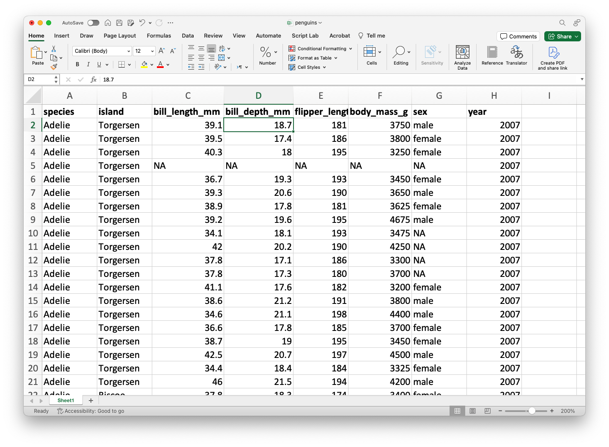
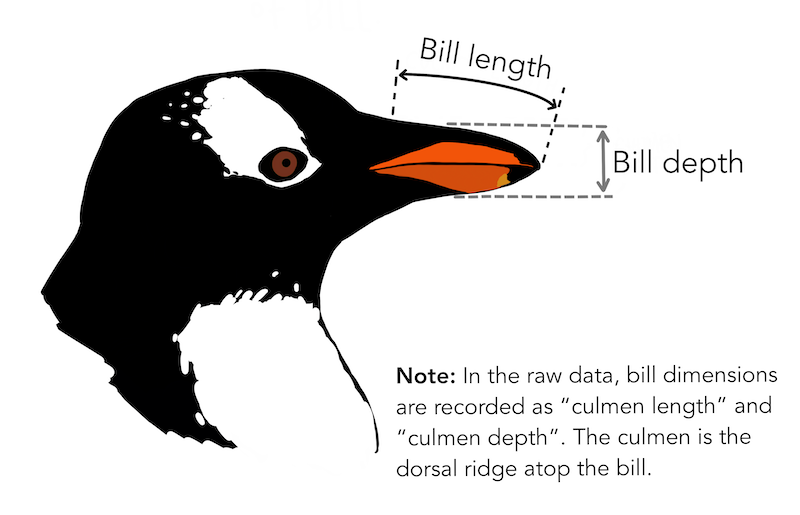
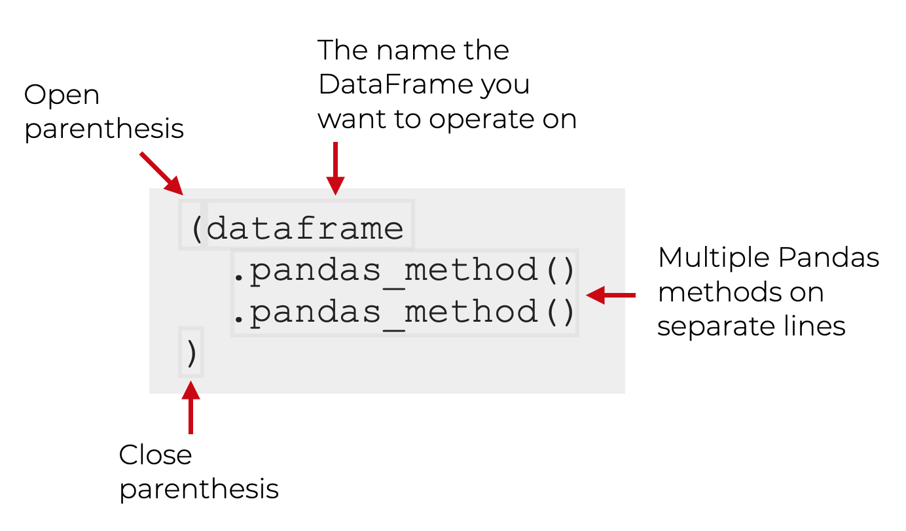
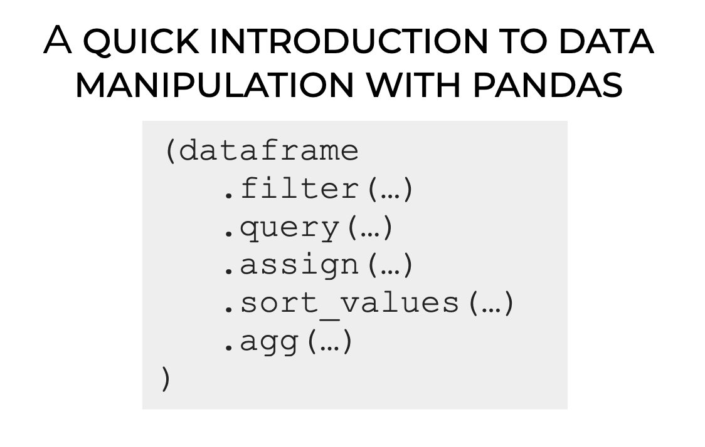

## Agenda

</br>

1.  Introduction to Python
2.  Reading data with **pandas**
3.  Data manipulation with **pandas**

# Introduction to Python

## Python

</br>

::::: columns
::: {.column width="70%"}
- A versatile programming language.

- It is free!

- It is widely used for data cleaning, data visualization, and data modelling.

- It can be extended with packages (libraries) developed by other users.
:::

::: {.column width="30%"}
{fig-align="center" width="324"}
:::
:::::

## Google Colab

*Google's free cloud collaboration platform for creating Python documents.*

- Run Python and collaborate on Jupyter notebooks for free.

- Harness the power of GPUs for free to accelerate your data science projects.

- Easily save and upload your notebooks to Google Drive.

{fig-align="right" width="2560"}


## Python libraries

</br>

Libraries are the fundamental units of reproducible Python code. They include reusable Python functions, documentation describing how to use them, and sample data.

</br>

In this course, we will be working mostly with the following libraries:

- **pandas** for data manipulation and wrangling
- **matplotlib** and **seaborn** for data visualization

# Reading data with pandas

## Loading data in Python

In this course, we will assume that data is stored in an Excel file with the above organization. As an example, let's use the file `penguins.xlsx`.

::::: columns
::: {.column width="50%"}
{width="418"}
:::

::: {.column width="50%"}
{width="396"}
:::
:::::

::: {style="font-size: 85%;"}
[***The file must be previously uploaded to Google Colab.***]{style="color:red;"}
:::

## 

The dataset `penguins.xlsx` contains data from penguins living in three islands.

{fig-align="center"}

## Alan Vazquez with a gentoo penguin

{fig-align="center"}

## pandas library

</br>

::::: columns
::: {.column width="30%"}
{fig-align="left"}
:::

::: {.column width="70%"}
- **pandas** is an open-source Python library for data manipulation and analysis.
- It is built on top of **numpy** for high-performance data operations.
- It allows the user to import, clean, transform, and analyze data efficiently
- <https://pandas.pydata.org/>
:::
:::::

## Importing pandas

Fortunately, the **pandas** library is already pre-installed in Google Colab.

</br>

However, we need to inform Google Colab that we want to use **pandas** and its functions using the following command:

```{python}
#| echo: true

import pandas as pd
```

</br>

The command `as pd` allows us to have a short name for **pandas**. To use a function of **pandas**, we use the command `pd.function()`.

## Loading data using pandas

</br>

The following code shows how to read the data in the file "penguins.xlsx" into Python.

```{python}
#| echo: true

# Load the Excel file into a pandas DataFrame.
penguins_data = pd.read_excel("penguins.xlsx")
```

## The function head()

The function `head()` allows you to print the first rows of a pandas data frame.

```{python}
#| echo: true
# Print the first 4 rows of the dataset.
penguins_data.head(4)
```

## Indexing variables a dataset

We can select a specific variables of a data frame using the syntaxis below.

```{python}
#| echo: true

penguins_data['bill_length_mm']
```

Here, we selected the variable `bill_length_mm` in the `penguins_data` dataset.

## 

To index multiple variables of a data frame, we put the names of the variables in a list object. For example, we select `bill_length_mm`, `species`, and `island` as follows:

```{python}
#| echo: true

sub_penguins_data = penguins_data[ ['bill_length_mm',  'species', 'island'] ]
sub_penguins_data.head()
```

## Indexing rows

To index rows in a dataset, we use the argument `loc` from **pandas**. For example, we select the rows 3 to 6 of the `penguins_dataset` dataset:

```{python}
#| echo: true

rows_penguins_data = penguins_data.loc[2:5]
rows_penguins_data
```

## 

</br>

```{python}
#| echo: true

rows_penguins_data
```

Note that the index 2 and 5 refer to observations 3 and 7, respectively, in the dataset. This is because the first index in Python is 0.

## Indexing rows and columns

Using `loc`, we can also retrieve a subset from the dataset by selecting specific columns and rows.

```{python}
#| echo: true

sub_rows_pdata = penguins_data.loc[2:5, ['bill_length_mm',  'species', 'island'] ]
sub_rows_pdata
```

# Data manipulation with pandas

## Chaining operations with pandas

One of the most important techniques in **pandas** is [**chaining**]{style="color:brown;"}, which allows for cleaner and more readable data manipulation.

The general structure of chaining looks like this:

{fig-align="center"}

## Key pandas methods

**pandas** provides methods or functions to solve common data manipulation tasks:

::: incremental
- `.filter()` selects specific columns or rows.

- `.query()` filters observations based on conditions.

- `.assign()` adds new variables that are functions of existing variables.

- `.sort_values()` changes the order of rows.

- `.agg()` reduces multiple values to a single numerical summary.
:::

## 

{fig-align="center"}

To practice, we will use the dataset `penguins_data`.

## Example

Let's load the dataset and the **pandas** library.

```{python}
#| echo: true

import pandas as pd

# Load the Excel file into a pandas DataFrame.
penguins_data = pd.read_excel("penguins.xlsx")

# Preview the dataset.
penguins_data.head(4)
```

## Selecting columns with `.filter()`

Select the columns `species`, `body_mass_g` and `sex`.

```{python}
#| eval: true
#| echo: true

(penguins_data
  .filter(["species", "body_mass_g", "sex"], axis = 1)
).head()
```

## 

</br>

The `axis` argument tells `.filter()` whether to select rows (`0`) or columns (`1`) from the dataframe.

```{python}
#| output: false
#| echo: true

(penguins_data
  .filter(["species", "body_mass_g", "sex"], axis = 1)
).head()
```

</br>

> The `.head()` command allows us to print the first six rows of the newly produced dataframe. We **must** remove it to have the entire new dataframe.

## 

</br>

We can also use `.filter()` to select rows too. To this end, we set `axis = 1`. We can select specific rows, such as 0 and 10.

```{python}
#| output: true
#| echo: true

(penguins_data
  .filter([0, 10], axis = 0)
)
```

## 

Or, we can select a set of rows using the function `range()`. For example, let's select the first 5 rows.

```{python}
#| output: true
#| echo: true

(penguins_data
  .filter(range(5), axis = 0)
)
```

## Filtering rows with `.query()`

</br>

An alternative way of selecting rows is `.query()`. Compared to `.filter()`, `.query()` allows us to filter the data using statements or *queries* involving the variables.

</br>

For example, let's filter the data for the species "Gentoo."

```{python}
#| output: false
#| echo: true

(penguins_data
  .query("species == 'Gentoo'")
)
```

## 

</br>

```{python}
#| output: true
#| echo: true

(penguins_data
  .query("species == 'Gentoo'")
).head()
```

## 

We can also filter the data to get penguins with a body mass greater than 5000g.

```{python}
#| eval: true
#| echo: true

(penguins_data
  .query("body_mass_g > 5000")
).head()
```

## 

We can even **combine** `.filter()` and `.query()`. For example, let's select the columns `species`, `body_mass_g` and `sex`, then filter the data for the "Gentoo" species.

```{python}
#| eval: true
#| echo: true

(penguins_data
  .filter(["species", "body_mass_g", "sex"], axis = 1)
  .query("species == 'Gentoo'")
).head(4)
```

## Create new columns with `.assign()`

</br>

With `.assign()`, we can create new columns (variables) that are functions of existing ones. This function uses a special Python keyword called `lambda`. Technically, this keyword defines an *anonymous* function.

</br>

For example, we create a new variable `LDRatio` equaling the ratio of `bill_length_mm` and `bill_depth_mm`.

```{python}
#| output: false
#| echo: true

(penguins_data
  .assign(LDRatio = lambda df: df["bill_length_mm"] / df["bill_depth_mm"])
)
```

## 

</br></br>

In this code, the `df` after `lambda` indicates that the dataframe (`penguins_data`) will be referred to as `df` inside the function. The colon `:` sets the start of the function.

```{python}
#| output: false
#| echo: true

(penguins_data
  .assign(LDRatio = lambda df: df["bill_length_mm"] / df["bill_depth_mm"])
)
```

The code appends the new variable to the end of the resulting dataframe.

## 

We can see the new variable using `.filter()`.

```{python}
#| output: true
#| echo: true

(penguins_data
  .assign(LDRatio = lambda df: df["bill_length_mm"] / df["bill_depth_mm"])
  .filter(["bill_length_mm", "bill_depth_mm", "LDRatio"], axis = 1)
).head()
```

## Sorting with `.sort_values()`

We can sort the data based on a column like `bill_length_mm`.

```{python}
#| eval: true
#| echo: true

(penguins_data
  .sort_values("bill_length_mm")
).head(4)
```

## 

To sort in descending order, use `ascending=False` inside `sort_values()`.

```{python}
#| eval: true
#| echo: true

(penguins_data
  .sort_values("bill_length_mm", ascending=False)
).head()
```

## Summarizing with `.agg()`

We can calculate summary statistics of the columns `bill_length_mm`, `bill_depth_mm`, and `body_mass_g`.

```{python}
#| eval: true
#| echo: true

(penguins_data
  .filter(["bill_length_mm", "bill_depth_mm", "body_mass_g"], axis = 1)
  .agg(["mean"])
)
```

</br>

> By default, `agg()` ignores missing values.

## Saving results in new objects

</br>

After performing operations on our data, we can save the modified dataset as a new object.

```{python}
#| eval: true
#| echo: true

mean_penguins_data = (penguins_data
  .filter(["bill_length_mm", "bill_depth_mm", "body_mass_g"], axis = 1)
  .agg(["mean"])
)

mean_penguins_data
```

## Saving pandas dataframes into Excel

</br></br>

Finally, we can save the **pandas** objects into an Excel file using the function `.to_excel()` as follows.

```{python}
#| eval: true
#| echo: true

# mean_penguins_data.to_excel("mean_penguins_data.xlsx")
```

</br>

> Of course, remove the \# symbol before running the code. 

## Programming culture: Trial and error

</br>

The best way to learn programming is to try things out and see what happens. Write some code, run it, and think about why it didn't work.

There are many ways to make small mistakes in programming (for example, typing a capital letter when a lowercase letter is needed).

We often have to find these mistakes through trial and error.

## Final remarks

</br>

- **pandas** is a library that allows us to manipulate data in Python.

- Variable types help specify the operations and visualizations we can apply to the data.

- There are appropriate or designed graphs for visualizing numeric or categorical variables.

- In this course, we will see several graphs for each variable type and their combinations.

# [Return to main page](https://alanrvazquez.github.io/TEC-IN2039-EN/)
