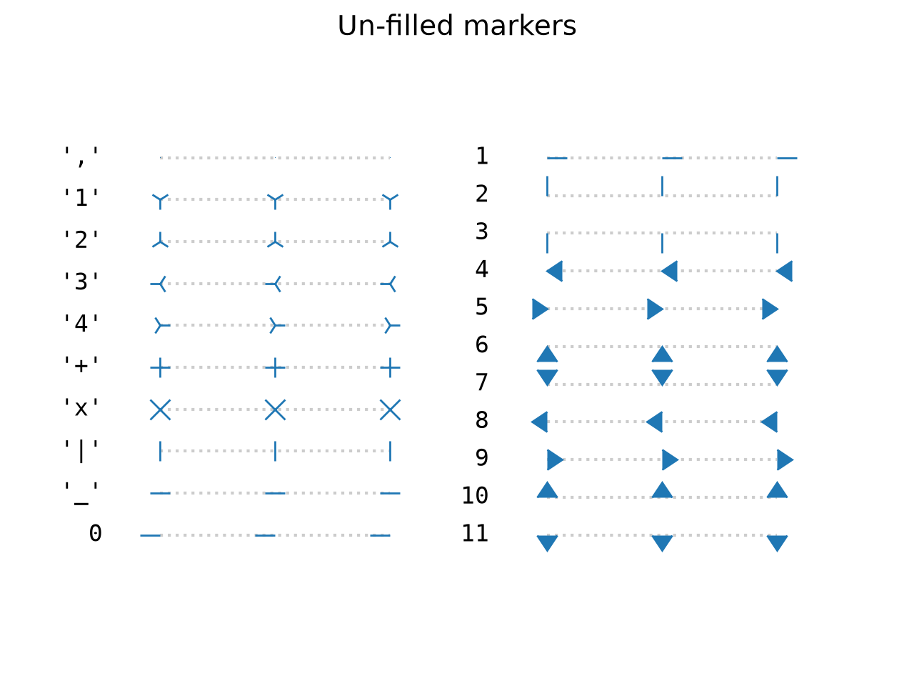
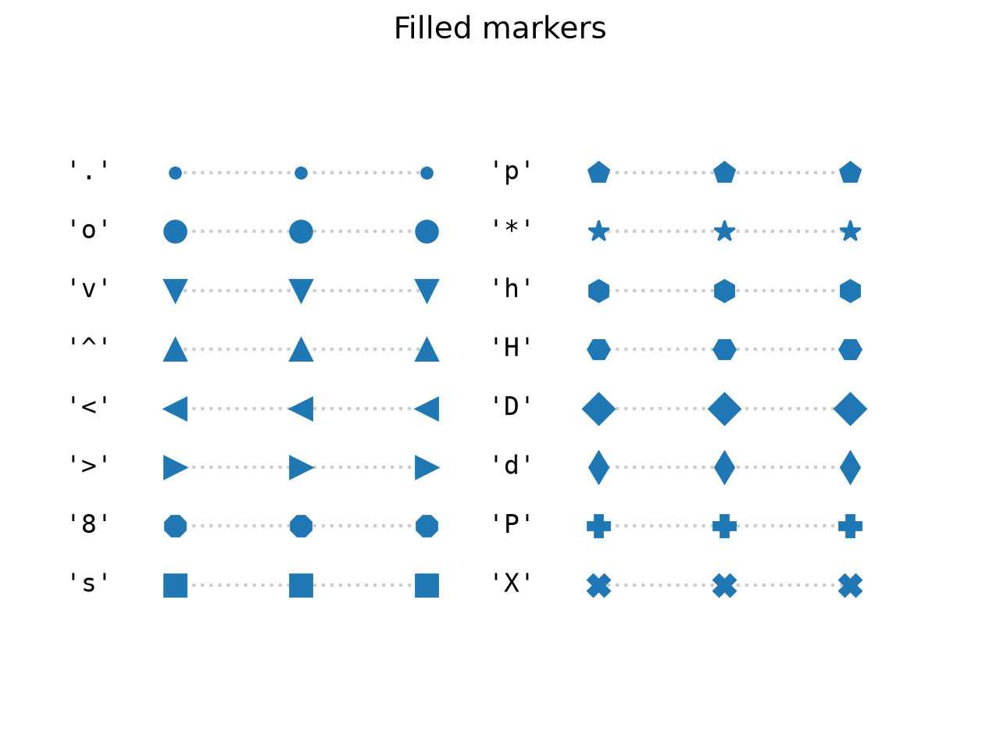

## Agenda

</br>

1.  Data with more than one variable
2.  Two numerical variables
3.  One numerical and one categorical variable
4.  Two categorical variables
5.  Three or more variables

## Load the libraries

</br></br>

We will use **pandas** to work with data, **seaborn** to create graphs, and **matplotlib** to customize them.

</br>

Let's import these libraries in Google Colab before starting.

```{python}
#| echo: true
#| output: false

import pandas as pd
import seaborn as sns
import matplotlib.pyplot as plt
```

## Multivariate data

</br>

Multivariate data consists of datasets that contain observations of two or more variables.

::: incremental
- Variables can be numerical or categorical.
- Variables may or may not be associated with each other.
:::

. . .

</br>

The **goal** is to determine whether the variables are related and to explore the type of relationship.

## Example 1

Consider data from 392 cars, including miles per gallon, number of cylinders, horsepower, weight, acceleration, model year, and origin.

The data are available in the file "auto_dataset.xlsx".

```{python}
#| echo: true

auto_data = pd.read_excel("auto_dataset.xlsx")
auto_data.head()
```

## Principle 1: Define the question

When working with multiple variables, typical questions include:

::: incremental
- How are variables $X$ and $Y$ related?
- Is the distribution of $X$ the same across the subgroups defined by $Z$?
- Are there any unusual observations when considering $X$ and $Y$ together?
- Are there any unusual values of $X$ within a subgroup defined by $Z$?
:::

## Principle 2: Turn data into information

Several types of graphs help us explore relationships between two or more variables.

::: center
| Variable types | Common graphs |
|:---|:---|
| Two numerical variables | Scatter plot, line graph |
| Two categorical variables | Side-by-side bar chart, stacked bar chart |
| Numerical and categorical variables | Side-by-side boxplots, dot plot, bar chart |
:::

::: notes
The types of variables determine which visualizations are appropriate.
:::

# Two Numerical Variables

## Independent and dependent variables

When investigating a relationship between two variables, we often use specific terminology.

. . .

The *dependent* or *response variable* is denoted by $Y$.

. . .

The *independent* or *predictor variable* is denoted by $X$.

. . .

</br>

> Our goal is to explore whether changes in $X$ are associated with changes in $Y$, and the nature of this association.

::: notes
An association does not, by itself, imply causation.
:::

## Scatter plot

</br>

The most common graph for examining the relationship between two numerical variables is a [***scatter plot***]{style="color:#174062;"}.

. . .

The variables $X$ and $Y$ are placed on the horizontal and vertical axes, respectively. Each point represents a pair of values $(X,Y)$.

. . .

</br>

> The goal is to explore linear or nonlinear relationships between the variables.

## Scatter plot in Python

</br></br>

To create a scatter plot with **seaborn**, we use `sns.scatterplot()`.

</br>

For example, let's explore the relationship between a car's weight (`weight`) and its fuel efficiency (`mpg`).

```{python}
#| fig-align: center
#| echo: true
#| output: false

plt.figure(figsize=(9, 5))
sns.scatterplot(data=auto_data, x="weight", y="mpg")
plt.show()
```

## 

</br></br>

```{python}
#| fig-align: center
#| echo: true

plt.figure(figsize=(9, 5))
sns.scatterplot(data=auto_data, x="weight", y="mpg")
plt.show()
```

## Principle 3: Apply graphic design principles

We can modify the default appearance of the graph to improve its readability.

</br>

For example, `color`, `marker`, and `s` control the color, shape, and size of the points, respectively.

</br>

`sns.scatterplot(data=data_set, x="X", y="Y", color=..., marker=..., s=...)`

## 

</br></br>

```{python}
#| fig-align: center
#| echo: true

plt.figure(figsize=(9, 5))
sns.scatterplot(data=auto_data, x="weight", y="mpg",
                color="blue", marker="x", s=100)
plt.show()
```

## Possible point shapes

</br>

To change the symbol used for the points, set `marker` to a symbol such as `"o"`, `"x"`, `"s"`, or `"^"`.

::::: columns
::: {.column width="50%"}
{fig-align="center" width="605"}
:::

::: {.column width="50%"}
{fig-align="center" width="605"}
:::
:::::

## Improving the scatter plot

We can also add a title and axis labels.

```{python}
#| fig-align: center
#| echo: true
#| code-fold: true

plt.figure(figsize=(9, 5))
sns.scatterplot(data=auto_data, x="weight", y="mpg",
                color="darkblue", s=50)
plt.title("Car weight and fuel efficiency")
plt.xlabel("Weight (lb)")
plt.ylabel("Miles per gallon")
plt.grid()
plt.show()
```

## Include zero

In the previous graph, the vertical axis starts above zero. If we want the vertical axis to start at zero, we can use `plt.ylim()`.

```{python}
#| fig-align: center
#| echo: true

plt.figure(figsize=(5.5, 2.5))
sns.scatterplot(data=auto_data, x="weight", y="mpg",
                color="darkblue", s=50)
plt.xlabel("Weight (lb)")
plt.ylabel("Miles per gallon")
plt.ylim(0, 50)
plt.grid()
plt.show()
```

## 

If necessary, we can also make the horizontal axis start at zero by using `plt.xlim()`.

```{python}
#| fig-align: center
#| echo: true

plt.figure(figsize=(6, 3))
sns.scatterplot(data=auto_data, x="weight", y="mpg",
                color="darkblue", s=50)
plt.xlabel("Weight (lb)")
plt.ylabel("Miles per gallon")
plt.xlim(0, 5500)
plt.ylim(0, 50)
plt.grid()
plt.show()
```

::: notes
Unlike bar charts, scatter plots do not always need axes to start at zero. Choose limits that support accurate interpretation.
:::

## Individual graphs

Graphs of individual variables (like histograms) do not allow us to examine the relationship between two variables. They only provide information about the *distribution* of each variable.

::::: columns
::: {.column width="50%"}
```{python}
#| fig-align: center
#| echo: true
#| code-fold: true

plt.figure(figsize=(4, 3))
sns.histplot(data=auto_data, x="mpg", color="darkblue")
plt.title("Distribution of fuel efficiency")
plt.xlabel("Miles per gallon")
plt.ylabel("Frequency")
plt.show()
```
:::

::: {.column width="50%"}
```{python}
#| fig-align: center
#| echo: true
#| code-fold: true

plt.figure(figsize=(4, 3))
sns.histplot(data=auto_data, x="weight", color="darkblue")
plt.title("Distribution of car weight")
plt.xlabel("Weight (lb)")
plt.ylabel("Frequency")
plt.show()
```
:::
:::::

## Line graph

A line graph connects data points with lines.

- $X$ (horizontal): usually time or another ordered variable.
- $Y$ (vertical): the numerical variable being measured.

Each point represents a value at a particular point in time or along the horizontal axis.

. . .

> The goal is to explore trends over time or changes in a continuous variable.

## Example 2

Consider the data in "spotify.xlsx", which contains global daily streams of five popular songs on Spotify in 2017.

```{python}
#| echo: true

spotify_data = pd.read_excel("spotify.xlsx")
spotify_data["Date"] = pd.to_datetime(spotify_data["Date"])
spotify_data.head(3)
```

## Line graph in Python

Let's focus on *Despacito* by Luis Fonsi. To create a line graph with **seaborn**, we use `sns.lineplot()`.

```{python}
#| fig-align: center
#| echo: true

plt.figure(figsize=(7, 4))
sns.lineplot(data=spotify_data, x="Date", y="Despacito")
plt.show()
```

## Applying Principle 3

</br>

We can customize the line using `linestyle`, `linewidth`, and `color`.

</br>

`sns.lineplot(data=data_set, x="X", y="Y", linestyle=..., linewidth=..., color=...)`

</br>

To change the appearance of the line, use a value of `linestyle` such as `"-"`, `"--"`, `":"`, or `"-."`.

## 

```{python}
#| fig-align: center
#| echo: true
#| code-fold: true

plt.figure(figsize=(9, 6))
sns.lineplot(data=spotify_data, x="Date", y="Despacito", 
              color="darkblue", linewidth=2)
plt.title("Popularity of Despacito by Luis Fonsi")
plt.xlabel("Date")
plt.ylabel("Daily Spotify streams")
plt.xticks(rotation=45)
plt.tight_layout()
plt.grid()
plt.show()
```

# One Categorical and One Numerical Variable

## Divide the data into groups!

To examine the relationship between a numerical and a categorical variable, we use the categorical variable to divide observations into groups. Then, we **compare the distribution** of the numerical variable across groups.

. . .

In this context:

- $X$ is the categorical variable.
- $Y$ is the numerical variable.

. . .

[**Side-by-side boxplots**]{style="color:#800080;"} are especially useful for comparing distributions across groups.

## Boxplots by groups

</br></br>

Side-by-side boxplots compare the distribution of a numerical variable across different groups.

</br>

We create them using **seaborn**:

`sns.boxplot(data=data_set, x="X", y="Y")`

## 

For example, let's compare the distributions of fuel efficiency for cars built in America, Europe, and Japan.

```{python}
#| fig-align: center
#| echo: true

plt.figure(figsize=(9, 5))
sns.boxplot(data=auto_data, x="origin", y="mpg")
plt.show()
```

## Applying Principle 3

```{python}
#| fig-align: center
#| echo: true
#| code-fold: true

plt.figure(figsize=(9, 6))
sns.boxplot(data=auto_data, x="origin", y="mpg",
            color="lightblue")
plt.xlabel("Origin")
plt.ylabel("Miles per gallon")
plt.grid()
plt.show()
```

## 

We can customize the appearance of outliers using the `flierprops` argument.

```{python}
#| fig-align: center
#| echo: true
#| code-fold: true

plt.figure(figsize=(7, 5))
sns.boxplot(data=auto_data, x="origin", y="mpg",
            color="lightblue",
            flierprops={"marker": "x", "markeredgecolor": "red",
                        "markersize": 8})
plt.xlabel("Origin")
plt.ylabel("Miles per gallon")
plt.grid()
plt.show()
```

## Plotting statistical summaries by group

</br>

Alternatively, we can summarize the numerical variable $Y$ for each category of $X$ using a statistic such as the **mean** or **median**.

For example, let's calculate average fuel efficiency by car origin using `groupby()` and `mean()` from **pandas**.

```{python}
#| echo: true

mean_mpg = auto_data.groupby("origin", as_index=False)["mpg"].mean()
mean_mpg = mean_mpg.rename(columns={"mpg": "mean_mpg"})
```

## 

The summary data are:

```{python}
#| echo: true

mean_mpg
```

Two common ways to visualize **one summary value per category** are:

- Cleveland dot plot
- Bar chart

## Cleveland dot plot

A Cleveland dot plot shows numerical values for different categories using points. It is an alternative to a bar chart.

```{python}
#| fig-align: center
#| echo: true

plt.figure(figsize=(7, 4))
sns.scatterplot(data=mean_mpg, x="mean_mpg", y="origin")
plt.show()
```

## Improving the plot

Apply Principle 3 to improve the appearance of the plot.

```{python}
#| fig-align: center
#| echo: true
#| code-fold: true

plt.figure(figsize=(8, 5))
sns.scatterplot(data=mean_mpg, x="mean_mpg", y="origin",
                color="deeppink", s=120)
plt.title("Average fuel efficiency by car origin")
plt.xlabel("Average miles per gallon")
plt.ylabel("Origin")
plt.xlim(0, 35)
plt.grid(axis="x")
plt.show()
```

## Bar chart

To create a bar chart whose bar lengths represent specified numerical values, we use `sns.barplot()`.

```{python}
#| fig-align: center
#| echo: true

plt.figure(figsize=(6, 4))
sns.barplot(data=mean_mpg, x="mean_mpg", y="origin",
            color="steelblue")
plt.show()
```

## 

We can use similar commands to improve the appearance of the bar chart.

```{python}
#| fig-align: center
#| echo: true
#| code-fold: true

plt.figure(figsize=(8, 5))
sns.barplot(data=mean_mpg, x="mean_mpg", y="origin",
            color="lightblue")
plt.title("Average fuel efficiency by car origin")
plt.xlabel("Average miles per gallon")
plt.ylabel("Origin")
plt.xlim(0, 35)
plt.grid(axis="x")
plt.show()
```

# Two Categorical Variables

## Divide the data into groups!

</br>

With two categorical variables, we compare the distribution of one variable across subgroups defined by the other variable.

In other words, we examine the distribution of one variable while grouping observations by another.

. . .

Two common visualizations are:

- Stacked bar charts
- Side-by-side bar charts

## Example 3

Consider the data in "penguins.xlsx".

```{python}
#| echo: true

penguins_data = pd.read_excel("penguins.xlsx")
penguins_data.head()
```

## 

</br></br>

The dataset contains two categorical variables:

- Penguin species (`species`).
- Island where the penguin was observed (`island`).

We can store categorical variables using the pandas `category` type.

```{python}
#| echo: true

penguins_data[["species", "island", "sex"]] = (
    penguins_data[["species", "island", "sex"]].astype("category")
)
```

## Stacked bar chart

A stacked bar chart represents counts for each category, with bars divided into segments according to a second categorical variable.

In **seaborn**, we can create this chart using `sns.histplot()` and `multiple="stack"`.

. . .

For example, let's examine the number of penguins of each species across the three islands.

```{python}
#| fig-align: center
#| echo: true
#| output: false

plt.figure(figsize=(7, 4))
sns.histplot(data=penguins_data, x="species", hue="island",
             multiple="stack", discrete=True)
plt.show()
```

## 

The chart shows the frequency of each penguin species, with each bar divided by island.

```{python}
#| fig-align: center
#| echo: true

plt.figure(figsize=(7, 4))
sns.histplot(data=penguins_data, x="species", hue="island",
             multiple="stack", discrete=True)
plt.xlabel("Species")
plt.ylabel("Frequency")
plt.show()
```

## Side-by-side bar chart

</br></br>

An alternative is to place the bars **side by side** within each category of the horizontal axis.

We can use `sns.countplot()` with `hue` to create these grouped bars.

```{python}
#| fig-align: center
#| echo: true
#| output: false

sns.countplot(data=penguins_data, x="species", hue="island")
plt.show()
```

## 

```{python}
#| fig-align: center
#| echo: true

plt.figure(figsize=(7, 5))
sns.countplot(data=penguins_data, x="species", hue="island")
plt.xlabel("Species")
plt.ylabel("Frequency")
plt.show()
```

## Stacked or side-by-side?

</br></br>

The main difference is that side-by-side bar charts show each subgroup in a separate bar, whereas stacked bar charts combine subgroups into one bar for each category.

Advantages of **stacked** bars:

- They show how each total is divided into segments.
- They make it easy to see overall totals.

## 

</br></br></br>

Advantages of **side-by-side** bars:

- They make it easier to compare the heights of individual bars.
- They are useful for comparing subgroups across categories.

## Statistical summaries

</br></br>

For categorical variables, common statistical summaries are **frequency** and **relative frequency**.

With **pandas**, `groupby()` and `size()` count observations in each combination of categories.

```{python}
#| echo: true
#| output: false

count_data = (penguins_data
              .groupby(["island", "species"], observed=True)
              .size()
              .reset_index(name="count"))
count_data
```

## 

```{python}
#| echo: true
#| output: true

count_data = (penguins_data
              .groupby(["island", "species"], observed=True)
              .size()
              .reset_index(name="count"))
count_data
```

## 

</br></br>

To calculate relative frequencies **within each island**, divide each count by the total number of penguins observed on that island.

```{python}
#| echo: true
#| output: false

count_data["proportion"] = (
    count_data["count"] /
    count_data.groupby("island", observed=True)["count"].transform("sum")
)
count_data
```

::: notes
For each island, the proportions across species add up to 1. Dividing by the grand total instead would answer a different question.
:::

## 

</br>

```{python}
#| echo: true
#| output: true

count_data["proportion"] = (
    count_data["count"] /
    count_data.groupby("island", observed=True)["count"].transform("sum")
)
count_data
```

# Three or More Variables

## Graphs for three variables

</br></br>

- When examining a distribution or relationship, we may want to compare it across subgroups.
- Conditioning on an additional variable leads to graphs involving three or more variables.
- Let's explore some common ways to visualize multiple variables.

## Scatter plot with color

To visualize **two numerical variables and one categorical variable**, we can represent the categorical variable through color using `hue`.

```{python}
#| fig-align: center
#| echo: true

plt.figure(figsize=(5, 3))
sns.scatterplot(data=auto_data, x="weight", y="mpg", hue="origin")
plt.xlabel("Weight (lb)")
plt.ylabel("Miles per gallon")
plt.show()
```

## Faceted or lattice plot

</br>

A faceted plot visualizes the relationship or distribution of one or two variables for each subgroup defined by a third variable $Z$.

. . .

**Idea:** Create a separate plot for each category of $Z$.

. . .

We can use the `relplot()` function from **seaborn** with `row` or `col`.

```{python}
#| fig-align: center
#| echo: true
#| output: false

plt.figure(figsize=(5, 3))
sns.relplot(data=auto_data, x="weight", y="mpg",
            row="origin", kind="scatter")
plt.show()
```

## 

::::: columns
::: {.column width="50%"}
</br></br>

The function creates a grid with **one column and three rows**. Each row corresponds to one category of `origin`.

```{python}
#| fig-align: center
#| echo: true
#| output: false

plt.figure(figsize=(5, 3))
sns.relplot(data=auto_data, 
            x="weight", y="mpg",
            row="origin", kind="scatter", 
            height=2.3, aspect=1.8)
plt.show()
```
:::

::: {.column width="50%"}
```{python}
#| fig-align: center
#| echo: false

plt.figure(figsize=(5, 3))
sns.relplot(data=auto_data, x="weight", y="mpg",
            row="origin", kind="scatter", height=2.3, aspect=1.8)
plt.show()
```
:::
:::::

## 

</br>

If we use `col="origin"` instead of `row="origin"`, we get **three columns and one row**.

```{python}
#| fig-align: center
#| echo: true

plt.figure(figsize=(7, 5))
sns.relplot(data=auto_data, x="weight", y="mpg",
            col="origin", kind="scatter", height=3, aspect=1.1)
plt.show()
```

## Multiple line graphs

</br></br>

We can use `sns.lineplot()` and seaborn's faceting options to visualize how the daily streams of the five songs in "spotify.xlsx" change over time.

However, we first need to reshape the data into a format that is suitable for these graphs.

## The required format

</br></br>

We need to combine the columns `Shape of You`, `Despacito`, `Something Just Like This`, `HUMBLE.`, and `Unforgettable` into **two columns**:

- One column will contain the song title.
- The other column will contain the number of streams.

The date will remain in the `Date` column.

## A useful pandas function

</br></br>

The `melt()` function in **pandas** transforms data from *wide format* into *long format*.

Long-format data are particularly useful for seaborn plots with grouping (`hue`) and faceting (`col`).

`pd.melt(data, id_vars=..., var_name=..., value_name=...)`

## Reshape the Spotify data

```{python}
#| echo: true

song_columns = ["Shape of You", "Despacito",
                "Something Just Like This", "HUMBLE.", "Unforgettable"]

data_lines = spotify_data.melt(
    id_vars="Date",
    value_vars=song_columns,
    var_name="Song",
    value_name="Streams"
)
data_lines.head()
```

## Faceted line graphs

</br></br>

Now we can create a line graph for each song.

```{python}
#| fig-align: center
#| echo: true
#| output: false

plt.figure(figsize=(5, 2))
sns.relplot(data=data_lines, x="Date", y="Streams",
            col="Song", col_wrap=3, kind="line",
            height=3, aspect=1.1)
plt.show()
```

## 

```{python}
#| fig-align: center
#| echo: false
#| output: true

plt.figure(figsize=(5, 2))
sns.relplot(data=data_lines, x="Date", y="Streams",
            col="Song", col_wrap=3, kind="line",
            height=3, aspect=1.1)
plt.show()
```

## Multiple lines in one graph

</br></br>

Alternatively, we can draw all five lines in a single graph using `hue="Song"`.

```{python}
#| fig-align: center
#| echo: true
#| output: false

plt.figure(figsize=(9, 5))
sns.lineplot(data=data_lines, x="Date", y="Streams", hue="Song")
plt.title("Daily Spotify streams by song")
plt.xlabel("Date")
plt.ylabel("Daily streams")
plt.xticks(rotation=45)
plt.tight_layout()
plt.grid()
plt.show()
```

## 

</br></br>

```{python}
#| fig-align: center
#| echo: false
#| output: true

plt.figure(figsize=(9, 5))
sns.lineplot(data=data_lines, x="Date", y="Streams", hue="Song")
plt.title("Daily Spotify streams by song")
plt.xlabel("Date")
plt.ylabel("Daily streams")
plt.xticks(rotation=45)
plt.tight_layout()
plt.grid()
plt.show()
```

## Graphs for four variables

A scatter plot can display four variables by mapping **two numerical variables** to the axes and using **color and point size** to represent two additional variables.

Here, both additional variables are categorical (`species` and `island`).

```{python}
#| fig-align: center
#| echo: true
#| output: false

plt.figure(figsize=(7, 4))
sns.scatterplot(data=penguins_data,
                x="bill_depth_mm", y="bill_length_mm",
                hue="species", size="island")
plt.show()
```

## 

```{python}
#| fig-align: center
#| echo: true

plt.figure(figsize=(7, 4))
sns.scatterplot(data=penguins_data,
                x="bill_depth_mm", y="bill_length_mm",
                hue="species", size="island", sizes=(40, 170))
plt.title("Penguin bill dimensions by species and island")
plt.xlabel("Bill depth (mm)")
plt.ylabel("Bill length (mm)")
plt.grid()
plt.show()
```

::: notes
Using size for categories is possible, but the ordering can suggest a quantitative ranking. Consider faceting by island when a clearer categorical comparison is needed.
:::

# More Graphs

For additional seaborn visualizations, see the [seaborn gallery](https://seaborn.pydata.org/examples/index.html).

# [Return to Main Page](https://alanrvazquez.github.io/TEC-IN2039-EN/)
